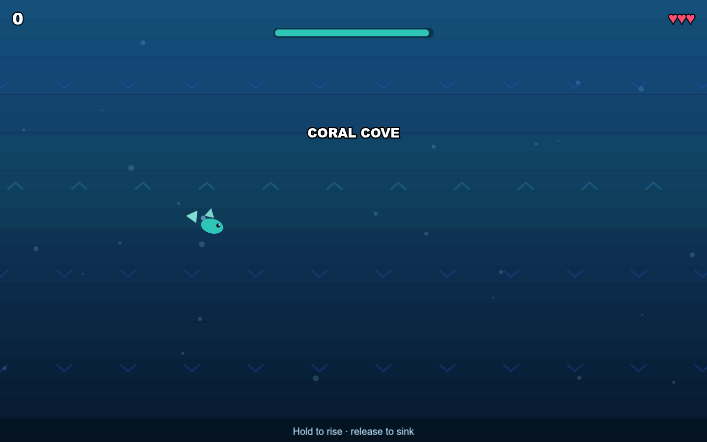
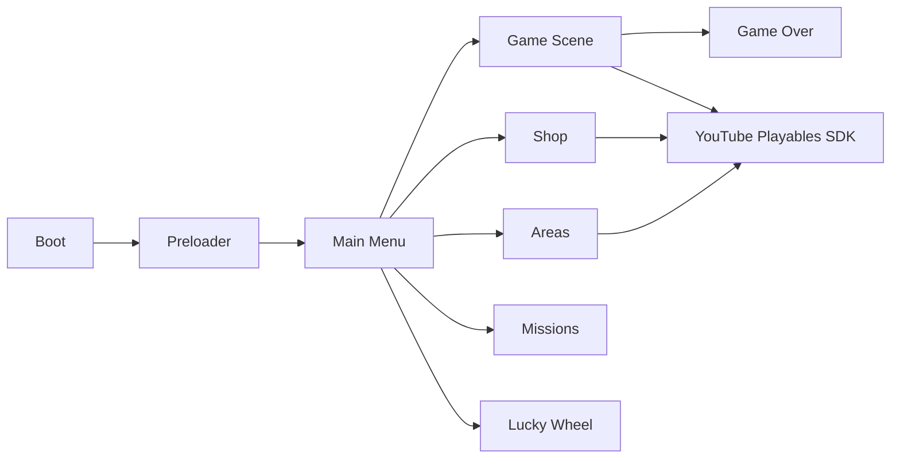

# Undertow

**Endless underwater arcade game for YouTube Playables** — TypeScript, Phaser 3, Vite.

[**Play the live demo**](https://musn0o.github.io/undertow/)



An endless underwater arcade game built for YouTube Playables.

Hold to rise, release to sink. Weave through coral gates and drifting
jellyfish, fight shifting currents, and grab air bubbles before your oxygen
runs out. Collect pearls for coins, earn XP to unlock new areas and swimmer
skins, complete daily missions, and spin the lucky wheel.

## Controls

- **Touch / Mouse:** hold to swim up, release to sink
- **Keyboard:** Space / ArrowUp / W to swim up
- **Esc:** close modals / go back

## Features

- Endless one-thumb arcade loop with near-miss slow-mo bonuses
- 10 unlockable swimmer skins and 7 areas with distinct look and difficulty
- In-game coin economy, XP/levels, daily missions, and a 5-minute lucky wheel
- Rewarded-ad continue and double-coins; interstitial at natural breakpoints
- Cloud saves inside Playables (localStorage fallback on the web demo)
- Fully responsive; touch, mouse, and keyboard input

## Projektüberblick (DE)

Undertow ist ein vollständig spielbares Browser-Arcade-Spiel im Stil eines
Endless-Runners. Der Spieler taucht durch Korallentore, weicht Quallen aus und
sammelt Luftblasen, bevor der Sauerstoff ausgeht. Das Projekt umfasst eine
komplette Spielschleife mit Fortschritt, Shop, täglichen Missionen, Werbe-
Integration und Cloud-Speicherung für YouTube Playables.

**Technischer Fokus:** Spielzustände und Szenen mit Phaser 3, TypeScript-
Typisierung, prozedurale Grafik und Audio zur Laufzeit, responsive Steuerung
sowie die Anbindung an das YouTube-Playables-SDK.

## Architecture



The game is organised into Phaser scenes (`src/scenes`), reusable UI
components (`src/ui`), game systems (`src/systems`) and a thin Playables
adapter (`src/playables`). All artwork is generated at runtime and all audio is
synthesised with the Web Audio API.

## Tech

[Phaser 3](https://phaser.io/) + TypeScript + Vite. No external assets and no
network calls: all artwork is generated at runtime and all audio is
synthesised with the Web Audio API.

## Run locally

```
npm install
npm run dev        # http://localhost:8080
npm run build      # production bundle in dist/
npm run preview    # serve the production build
```

Dev deep links: append `#play`, `#shop`, `#areas`, `#wheel`, or `#missions`
to jump straight to a screen.

## Deploy

Deployed to GitHub Pages via `.github/workflows/deploy.yml` (push to `main`).
Any static host works — the game is a self-contained build in `dist/`.

## YouTube Playables integration

The Playables SDK is loaded before any game code. Readiness
(`firstFrameReady` then `gameReady`), pause/resume, audio mute, cloud save,
score reporting and ads are wired through
`src/playables/YouTubePlayables.ts`.

Playable: https://musn0o.github.io/undertow/
